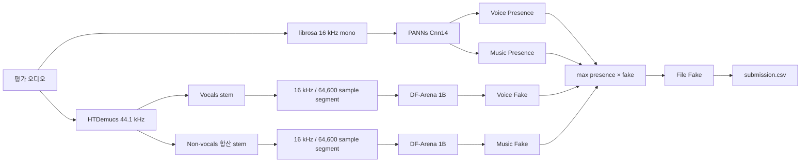

# 딥보이스 탐지 baseline 제출 포맷 분석

> 분석 대상: `format/baseline_submit`
> 분석 기준일: 2026-08-28 (Asia/Seoul)
> 분석 방법: 소스·설정·모델 카드·체크섬·더미 입력에 대한 정적 검사. 모델 체크포인트 추론은 실행하지 않음.

## 1. 결론

이 baseline은 **대회의 입력과 다섯 출력 계약을 이해하기 좋은 제로샷 참고 구현**이다. 함수가 단계별로 나뉘어 있고, 모델을 로컬에 고정하며, 파일 ID와 제출 행을 엄격하게 맞춘다. 음성·음악 존재 여부, 성분 분리, 성분별 Fake 판정을 서로 다른 사전학습 모델에 맡기는 발상도 문제 정의와 직관적으로 대응한다.

그러나 **상위권 경쟁 모델이나 실무 배포 모델의 구조로 보기는 어렵다**. 가장 큰 이유는 다음과 같다.

1. 악기 중심 AI 음악을 음성 위조 판별 모델로 판정하는 도메인 불일치가 있다.
2. HTDemucs 분리 오류와 분리 과정에서 생긴 artifact가 Fake 판정에 그대로 전파된다.
3. 원본 mixture의 법과학적 단서를 버리고 분리 stem만 판정한다.
4. 1B SSL 모델을 음성·음악 stem마다 반복 실행하여 1,200개 파일/60분 제한을 만족하는지 확인되지 않았다.
5. 스테레오 단서 손실, 반복 패딩 경계, 긴 파일의 최대값 편향, presence와 Fake의 취약한 규칙 결합이 있다.

따라서 이 코드는 **제출 형식·오프라인 실행·기본 모델 연결을 확인하는 출발점**으로는 좋지만, 학습 데이터 구성과 다중 도메인 검증, 원본 mixture 기반 판정, 배치 추론, 학습형 파일 결합이 추가되어야 한다.

## 2. 확인된 사실과 확인하지 못한 것

### 2.1 직접 확인한 항목

- `script.py`는 Python AST 구문 검사를 통과했다.
- 더미 WAV 3개는 모두 16 kHz, mono, PCM 16-bit, 3.405초이며 SHA-256이 동일하다.
  - `FF2B127A79B5E6A3B9E9C3EAA1D6552A862A11C4104279831EE5B5AF8E114203`
- 포함 모델은 DF-Arena 1B 약 4.28 GiB, PANNs Cnn14 약 312 MiB, HTDemucs 약 80 MiB다.
- `SHA256SUMS.txt`에는 세 모델 가중치의 체크섬이 있다.
- DF-Arena 설정은 `spoof=0`, `bonafide=1`, 16 kHz, 이진 분류다.
- baseline의 모델·코드 경로와 다섯 출력 컬럼은 대회 샘플 포맷과 일치한다.
- 공식 대회는 별도의 학습 데이터를 제공하지 않는다. 실제 평가는 4초~1분 길이의 1,200개 파일이며, mono/stereo와 MP3/WAV/FLAC 등 여러 포맷, 전화채널 표본을 포함한다. [대회 설명](https://www.dacon.io/competitions/official/236749/overview/description), [데이터 설명](https://www.dacon.io/competitions/official/236749/data)

### 2.2 미검증 항목

- baseline의 정확도, EER, ROC-AUC 및 리더보드 점수
- L4에서 1,200개 파일 전체 추론 시간과 peak VRAM/RAM
- 실제 평가 서버에서의 패키지 설치 및 모델 로드 성공 여부
- HTDemucs stem에 대한 DF-Arena 출력의 확률 보정 상태
- README에 기재된 개별 데이터셋 성능의 현 체크포인트 재현 여부

현재 호스트에는 baseline의 주요 런타임 의존성이 설치되어 있지 않고, `load_htdemucs_model()`이 pickle 기반 체크포인트를 `weights_only=False`로 여는 구조다. 외부 가중치의 실행은 체크섬·출처·로드 경로를 별도 검토한 뒤 격리 환경에서 수행해야 하므로 이번 분석에서는 실행하지 않았다. 동일한 더미 파일 3개로는 정확도를 판단할 수도 없다.

## 3. 대회 목표와 점수상 우선순위

공식 점수는 다음과 같다.

```text
Score = 0.9 × ADS + 0.1 × CPS

ADS = 0.5 × (1 - File EER)
    + 0.2 × (1 - Voice EER)
    + 0.3 × (1 - Music EER)

CPS = 0.5 × Voice Presence ROC-AUC
    + 0.5 × Music Presence ROC-AUC
```

최종 Score에 대한 실질 가중치는 다음과 같다. [공식 평가 기준](https://www.dacon.io/competitions/official/236749/overview/evaluation)

| 항목 | 최종 가중치 | 의미 |
|---|---:|---|
| File Fake EER | 0.45 | 가장 중요한 목표 |
| Music Fake EER | 0.27 | 음성보다 높은 성분별 가중치 |
| Voice Fake EER | 0.18 | 음성 성분이 존재하는 표본에서 계산 |
| Voice Presence AUC | 0.05 | 존재 여부의 순위 품질 |
| Music Presence AUC | 0.05 | 존재 여부의 순위 품질 |

EER와 ROC-AUC는 개별 점수에 대한 단조 변환에는 불변이다. 따라서 단순 확률 calibration보다 **표본 순위와 도메인 일반화**가 중요하다. 다만 baseline처럼 presence와 Fake를 곱하고 최대값을 취하면 표본 순서 자체가 바뀌므로, 결합식은 여전히 성능에 큰 영향을 준다.

## 4. 전체 추론 구조



실행 순서는 [`script.py`](../format/baseline_submit/script.py)의 `main()`에 그대로 드러난다.

1. 파일 목록과 sample submission ID 검증 (`script.py:80-150`)
2. PANNs로 존재 확률 계산 (`script.py:182-241`)
3. HTDemucs로 음성/음악 분리 (`script.py:248-308`)
4. 각 stem을 DF-Arena 1B로 판정 (`script.py:315-354`)
5. 규칙 기반 File Fake 결합과 CSV 저장 (`script.py:361-426`)

## 5. 모듈별 분석

### 5.1 입력·제출 계약

#### 좋은 점

- 지원 확장자를 명시하고 대소문자를 정규화한다.
- ID 중복, 빈 ID, 누락 컬럼, 오디오/제출 ID 불일치를 조기에 실패시킨다.
- 제출 행의 순서를 sample submission 기준으로 복원한다.
- `utf-8-sig` 입력과 UTF-8 출력을 사용해 BOM이 있는 CSV도 처리한다.
- 출력 폴더를 자동 생성하고 원래 컬럼 순서를 보존한다.

#### 개선할 점

- 한 파일의 디코딩 실패가 전체 제출을 중단한다. 파일별 오류 로그와 정책적으로 안전한 fallback이 없다.
- 입력 폴더 바로 아래 파일만 읽는다. 공식 구조가 flat이므로 현재는 맞지만 재사용성은 낮다.
- 결과값이 finite인지, `[0,1]` 범위인지 저장 전에 검증하지 않는다.
- 처리된 ID 수, 오류 수, 파일별 시간, 전체 peak memory를 기록하지 않는다.

### 5.2 세그먼트 처리

`SEGMENT_SAMPLES=64_600`은 16 kHz에서 4.0375초다. 긴 파일은 64,600 샘플 간격의 비중첩 창으로 나누고 끝 창을 한 번 추가한다. 짧은 파일은 파형을 반복해 채운다.

#### 장점

- DF-Arena 원 모델이 사용하는 길이와 일치한다.
- 마지막 구간을 반드시 포함한다.
- 완전한 zero padding보다 짧은 음성의 평균 에너지를 유지한다.

#### 문제점

- 대회 최소 길이는 4초다. 4초 파일은 600 샘플을 채우기 위해 시작부를 이어 붙여 경계 불연속을 만든다.
- 파일 길이가 창 길이보다 조금 긴 경우 앞 창과 끝 창이 대부분 겹쳐 계산이 중복된다.
- 모든 segment의 최댓값을 파일 점수로 사용하면 파일이 길수록 우연한 고점이 발생할 가능성이 커진다.
- Fake가 짧게 존재하는 경우 max가 유리할 수 있지만, 분리 artifact나 잡음 한 구간에도 지나치게 민감하다.

권장 대안은 학습된 multi-instance attention, top-k 평균 또는 log-sum-exp pooling이다. 반복 패딩 대신 reflect padding, 마지막 유효 구간 mask, 길이에 따른 window 정책을 검증해야 한다.

### 5.3 PANNs 존재 여부 추론

PANNs Cnn14의 AudioSet 태그 중 voice 18개, music 약 110개를 묶고, 모든 segment·모든 태그 중 최대 확률을 각각 반환한다.

#### 장점

- 음성, 노래, 합창, 랩, 허밍을 voice로 묶어 대회의 “보컬은 음성” 정의를 반영한다.
- 악기 및 장르 태그를 폭넓게 music으로 묶는다.
- 범용 audio tagging 모델을 이용해 별도 학습 데이터가 없는 상황에서도 바로 출력할 수 있다.

#### 문제점

- 서로 다른 calibration을 가진 수십~수백 태그의 최대값은 성분 존재 확률과 같지 않다.
- music 후보 태그 수가 voice보다 훨씬 많아 다중 비교 편향이 생길 수 있다.
- 긴 파일일수록 segment 수가 증가해 최대값 오탐 가능성이 커진다.
- stereo를 mono 평균한 입력만 사용해 공간·채널 단서를 버린다.
- `prepare_panns_labels()`가 실행마다 `$HOME/panns_data`에 파일을 복사한다. 제출 디렉터리 밖의 전역 상태에 의존하고 동시 실행에 취약하다.

PANNs는 독립적인 최종 확률기보다 **초기 feature 또는 보조 teacher**로 쓰고, 대회 라벨 정의에 맞춘 voice/music presence head를 별도로 학습하는 편이 낫다.

### 5.4 HTDemucs 음성·음악 분리

HTDemucs는 vocals와 나머지 세 stem을 분리한다. vocals는 voice로, drums/bass/other의 합은 music으로 정의한다.

#### 장점

- 음성과 음악이 동시 존재하는 혼합 표본을 성분 단위로 보려는 문제 정의와 잘 맞는다.
- 원본 stereo를 Demucs 입력으로 사용하고, 공식 사전학습 가중치를 로컬에 포함한다.
- `shifts=0`, split 추론, 0.25 overlap은 재현성과 속도를 고려한 선택이다.

#### 문제점

- 분리는 완벽하지 않다. vocals leakage와 accompaniment leakage가 두 Fake head를 동시에 오염시킨다.
- DF-Arena는 원본 오디오 분포에서 학습되었는데 Demucs가 만든 stem은 별도 도메인이다. 실제 Real도 분리 artifact 때문에 Fake로 보일 수 있다.
- 원본 mixture를 직접 판정하지 않아 생성기의 전역 codec/phase/long-range artifact를 잃는다.
- 전체 파일을 44.1 kHz로 올려 무거운 분리를 수행한 뒤 다시 16 kHz로 내린다.
- PANNs 단계에서 이미 한 번 디코딩한 파일을 Demucs가 다시 읽는다.
- `mono_waveform = waveform.mean(0)`의 평균과 표준편차로 stereo 전체를 정규화한다. 좌우 채널이 역상에 가까우면 mono가 상쇄되어 실제 신호가 있는데도 무음 분기로 갈 수 있다.

따라서 분리 stem은 원본 mixture와 함께 쓰는 **보조 view**가 적절하다. 독립 검증에서 이득이 없거나 시간 제한을 넘으면 inference에서는 제거해야 한다.

### 5.5 DF-Arena 1B Fake 추론

DF-Arena 1B는 wav2vec2 XLS-R 1B의 hidden states를 학습형 layer weighting으로 합친 뒤 Conformer 분류기에 입력한다. 모델 카드에 따르면 전통적인 speech anti-spoofing뿐 아니라 singing 및 environmental deepfake 데이터도 학습에 포함된다.

#### 장점

- raw waveform 기반 SSL 표현은 특정 spectrogram 한 종류에 묶이지 않는다.
- 여러 SSL layer를 학습형으로 결합하고 Conformer로 시간 정보를 통합한다.
- 공개된 다양한 anti-spoofing 데이터로 zero-shot 일반화를 노린 모델이다.
- `local_files_only=True`와 offline 환경변수로 평가 중 외부 다운로드를 막는다.

#### 문제점

- 제공된 학습 목록만으로는 **보컬이 없는 AI 생성 악기 음악**에 대한 충분한 커버리지를 확인할 수 없다. music stem에 동일 분류기를 그대로 쓰는 것은 근거가 약하다.
- 1B backbone을 각 segment와 두 stem에 직렬 적용한다. 코드상 batch 입력을 전제로 작성되지 않아 GPU 효율이 낮다.
- 모델 내부 feature extractor는 실제 baseline 경로에서 사용되지 않는다. 길이 처리 책임이 두 곳에 중복되어 있다.
- `os.chdir(DF_ARENA_DIR)`로 상대 경로 설정을 만족시키는 방식은 전역 작업 디렉터리를 잠시 바꾸므로 재사용성과 동시성에 취약하다.
- 4.28 GiB 가중치와 stem별 반복 추론은 L4 22.4 GiB에서 메모리에는 들어갈 가능성이 높지만, 처리량은 실측 전까지 알 수 없다.

최근 RAPTOR 연구는 1B 규모보다 SSL pretraining trajectory와 cross-domain 검증이 더 중요하며, 약 100M multilingual SSL 모델도 경쟁 가능한 일반화를 보일 수 있음을 보고한다. 다만 이 역시 별도 데이터에서의 연구 결과이므로 본 대회 성능은 직접 검증해야 한다. [RAPTOR](https://arxiv.org/abs/2603.06164)

### 5.6 File Fake 결합

현재 식은 다음과 같다.

```python
voice_score = voice_present * voice_fake
music_score = music_present * music_fake
file_fake = max(voice_score, music_score)
```

#### 장점

- 존재하지 않는 성분의 불안정한 Fake 점수를 낮추려는 의도가 명확하다.
- “둘 중 하나라도 Fake면 파일 Fake”라는 규칙을 최대값으로 근사한다.

#### 문제점

- 생성 음성이 PANNs에서 자연 음성보다 덜 speech-like하게 보이면 `voice_present`가 낮아져, 정작 Fake 표본의 file score를 억제한다.
- 두 성분이 중간 수준으로 의심스러워도 max는 증거를 합치지 않는다.
- presence와 Fake가 보정된 조건부 확률이라는 근거가 없다.
- 분리 stem 점수만 사용하고 원본 파일을 직접 판정한 score가 없다.

최소 대안은 다음 noisy-or다.

```text
q_voice = P(voice present) × P(voice fake | voice present)
q_music = P(music present) × P(music fake | music present)
P(file fake) = 1 - (1 - q_voice) × (1 - q_music)
```

경쟁 구조에서는 원본 mixture Fake head와 component 점수를 OOF(out-of-fold) 예측만으로 학습한 meta-fusion이 더 적합하다. 비공개 평가 파일 사이의 통계나 pseudo-label을 쓰면 안 된다. [대회 규칙](https://www.dacon.io/competitions/official/236749/overview/rules)

## 6. 코드 품질 평가

| 관점 | 평가 | 근거 |
|---|---|---|
| 가독성 | 양호 | 단계별 주석과 작은 함수, 명확한 상수 |
| 제출 계약 준수 | 양호 | ID·컬럼·출력 경로 검증 |
| 오프라인 재현성 | 보통 | 로컬 모델 고정은 좋으나 버전·런타임 검증 부족 |
| 오류 복구 | 미흡 | 한 파일 오류가 전체 작업 중단 |
| 테스트 가능성 | 보통 이하 | 순수 함수 일부는 좋지만 테스트와 fixture 없음 |
| 보안 | 개선 필요 | `weights_only=False`, 런타임 체크섬 미검증 |
| 성능 공학 | 미흡 | 중복 디코딩, 직렬 추론, 무거운 분리, batch 부재 |
| 확장성 | 미흡 | 전역 cwd와 home 파일, 단일 script에 모든 역할 집중 |

### requirements.txt 해석

`requirements.txt`에는 사용하지 않는 `matplotlib==3.9.2`만 있다. 반면 script는 librosa, numpy, torch, torchaudio, demucs, panns-inference, transformers, accelerate, tqdm 등을 사용한다.

이것을 곧바로 “의존성 누락으로 실행 불가”라고 판정하면 부정확하다. 공식 평가 서버에는 해당 핵심 패키지가 기본 설치되어 있고, 오히려 이미 설치된 버전을 requirements에 다시 넣지 말라고 권고한다. 문제는 다음 두 가지다.

1. 실제로 쓰지 않는 matplotlib을 서버 기본 3.10.8과 다른 3.9.2로 내리려 한다.
2. standalone 재현 환경을 설명하는 manifest로는 부족하다.

제출용 requirements는 비워 두거나 정말 추가 설치가 필요한 것만 넣고, 별도 개발 lockfile/환경 명세에 전체 버전을 기록하는 편이 맞다. [공식 코드 제출 가이드](https://www.dacon.io/competitions/official/236749/overview/evaluation)

## 7. 위험 우선순위

| 우선순위 | 위험 | 영향 | 먼저 확인할 것 |
|---:|---|---|---|
| P0 | L4 60분 처리량 미검증 | 제출 실패 | 10/100개 실측 후 1,200개 외삽 |
| P0 | music Fake 도메인 불일치 | 점수 27% 직접 손실 | 합성 악기 음악 holdout EER |
| P0 | separator artifact 전파 | Real 오탐·Fake 누락 | 원본/분리/병렬 view ablation |
| P1 | 원본 mixture head 부재 | 전역 artifact 손실 | mixture 전용 head 추가 |
| P1 | mono 평균과 역상 상쇄 | stereo 오판 | mid/side 및 채널별 테스트 |
| P1 | max pooling 길이 편향 | 1분 파일 오탐 | 길이별 EER, top-k/attention 비교 |
| P1 | presence×fake 결합 | File EER 악화 | noisy-or와 OOF fusion 비교 |
| P2 | batch 부재·중복 decode | 처리량 저하 | 공통 decoder와 batched segment |
| P2 | checkpoint load 보안 | 공급망 위험 | 체크섬 선검증, 격리 실행 |
| P2 | 전역 상태·로그 부족 | 재현 실패 | cwd/home 제거, manifest와 로그 |

## 8. 권장 개선 순서

1. **측정 기반선 확보**
   체크섬 검증 후 격리된 L4 환경에서 10개/100개 표본의 시간, peak VRAM/RAM, 오류를 기록한다. 성능 데이터가 없으므로 이 단계에서 정확도를 주장하지 않는다.

2. **원본 mixture 경로 추가**
   분리 전 원본의 Fake score를 만들고, stem 기반 경로와 비교한다. 분리는 유효성 검증을 통과한 보조 view로 격하시킨다.

3. **음악 전용 판별기 도입**
   speech anti-spoofing 모델 재사용 대신 multi-resolution spectral/codec residual과 장기 음악 구조를 학습한다.

4. **compact SSL 및 batch 추론**
   약 100M multilingual SSL voice branch, mixed precision, 공통 segment batch로 처리량을 확보한다.

5. **스테레오·segment·결합 개선**
   mid/side 특징, mask-aware padding, attention/top-k pooling, OOF noisy-or/meta-fusion을 검증한다.

6. **재현성과 보안 보강**
   모델 체크섬을 로드 전에 확인하고, 전역 monkey patch/cwd/home 쓰기를 제거하며, 버전·데이터·모델 manifest와 실패 로그를 남긴다.

## 9. 최종 판정

| 질문 | 답변 |
|---|---|
| 어떤 코드인가? | 세 범용 사전학습 모델을 직렬 연결한 offline zero-shot 오디오 deepfake baseline |
| 코드 구조가 좋은가? | 제출 계약과 설명용 구조는 좋지만, 보안·오류 복구·테스트·성능 공학은 부족 |
| 음성 추론 구조가 좋은가? | voice-only 단순 표본의 출발점으로는 합리적이나 stereo·segment·분리 도메인 문제 존재 |
| 음악 추론 구조가 좋은가? | 음악 존재 판별은 출발점이 되지만, music Fake에 speech detector를 재사용해 경쟁력이 약함 |
| 그대로 제출할 가치가 있는가? | 실행 확인용 baseline으로는 있음. 상위권 전략으로는 구조 변경과 자체 학습이 필요 |

## 10. 참고자료

- [DACON 대회 개요 및 문제 정의](https://www.dacon.io/competitions/official/236749/overview/description)
- [DACON 평가 산식 및 실행 환경](https://www.dacon.io/competitions/official/236749/overview/evaluation)
- [DACON 데이터 구성](https://www.dacon.io/competitions/official/236749/data)
- [DACON 규칙: 공개 자원, 출처, 평가 파일 독립성](https://www.dacon.io/competitions/official/236749/overview/rules)
- [DF-Arena/RAPTOR: Do Compact SSL Backbones Matter?](https://arxiv.org/abs/2603.06164)
- [AASIST](https://arxiv.org/abs/2110.01200)
- [RawBoost](https://arxiv.org/abs/2111.04433)
