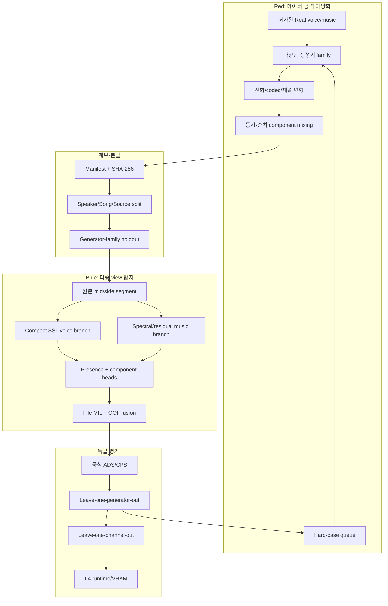

# 생성–탐지 공진화 전략: 폐쇄형 Red–Blue 오디오 Deepfake 대응

> 대상: DACON 딥보이스 범죄 대응 AI 탐지 모델 경진대회
> 범위: 음성, 노래 보컬, 악기 음악, 동시/순차 혼합과 다섯 예측값 전체
> 기준일: 2026-08-28 (Asia/Seoul)
> GPU 예산: Hugging Face 유료 GPU 사용액 $20 미만

## 1. 추천 전략

단일 생성기와 단일 탐지기를 번갈아 최적화하는 단순 “경찰–도둑” 방식보다 **Red–Blue Co-evolution Data Engine**을 권장한다.

핵심 차이는 생성기가 한 탐지기의 허점을 직접 과적합해 숨는 것이 아니라, 다음 네 축을 체계적으로 확장한다는 점이다.

1. 생성 방식: TTS, voice conversion, codec language model, singing synthesis/conversion, end-to-end music generation
2. 원본 환경: 화자, 언어, 노래, 장르, 녹음 장비, mono/stereo
3. 전달 채널: 전화 대역, 재표본화, codec, 압축, 잡음, 리버브, AGC, clipping
4. 구성 방식: voice-only, music-only, 동시 혼합, 순차 혼합과 Real/Fake 조합

Blue detector가 틀린 표본은 다음 Red 라운드의 hard-case 큐에 들어간다. 그러나 최종 일반화 평가용 generator family와 원천 데이터는 Red와 Blue 양쪽에 끝까지 공개하지 않는다. 이 구조가 “탐지기를 이기는 공격”을 **방어 학습용, 계보가 남는 폐쇄형 challenge set**으로 바꾼다.

## 2. 목표와 안전 경계

### 2.1 목표

- `FILE_FAKE_PROB`, `VOICE_FAKE_PROB`, `MUSIC_FAKE_PROB`, `VOICE_PRESENT_PROB`, `MUSIC_PRESENT_PROB`을 파일별로 독립 예측한다.
- 공식 최종 점수의 실질 가중치인 File 0.45, Music Fake 0.27, Voice Fake 0.18, 두 Presence 각 0.05를 학습·검증 우선순위에 반영한다. [공식 평가](https://www.dacon.io/competitions/official/236749/overview/evaluation)
- 보지 못한 생성기, codec, 채널, 화자/곡에서 성능이 유지되는지를 IID validation보다 우선한다.
- L4 22.4 GiB, 1,200개 파일, 60분 제한 안에 재현 가능한 제출물을 만든다. [대회 설명](https://www.dacon.io/competitions/official/236749/overview/description)

### 2.2 폐쇄형 Red 산출물

- 합법적으로 확보한 real source와 생성 모델로 만든 라벨 확정 합성 오디오
- 생성기 family, 모델 revision, seed, source consent/license, codec, 채널, 변환 이력 manifest
- Blue가 놓친 hard-case ID와 오류 유형
- generator-family별 EER/AUC와 채널 강건성 보고서
- 재현 가능한 내부 생성 recipe의 hash와 환경 lockfile

### 2.3 범위 밖

- 특정인의 무단 사칭용 음성 모델이나 corpus
- 제3자 서비스의 탐지기를 우회하도록 최적화한 배포형 모델·API
- 계보를 제거한 고품질 사칭 오디오의 공개 배포
- 비공개 평가 파일을 이용한 학습, pseudo-labeling, 표본 간 정규화

Red 산출물은 private 저장소에 두고 승인된 연구·대회 학습에만 사용한다. 공개 demo가 필요하면 원본 음성을 제공하지 않고 통계·오류 분류·모델 카드만 노출한다.

## 3. 전체 시스템



## 4. 데이터 전략

대회는 학습 데이터를 제공하지 않으므로 데이터 구성이 모델 선택보다 먼저다. [공식 데이터 안내](https://www.dacon.io/competitions/official/236749/data)

### 4.1 데이터 소스 계층

| 계층 | 목적 | 후보 | 사용 조건 |
|---|---|---|---|
| Real speech | 자연 발화 분포 | 공개 speech corpus, 동의된 자체 녹음 | 화자·문장·source 분리, 라이선스 확인 |
| Fake speech | TTS/VC/codec LM | ASVspoof, MLAAD, Codecfake/CodecFake 및 허용된 생성 모델 | generator family와 revision 기록 |
| Real singing | 자연 보컬 | 라이선스가 명확한 singing corpus | 가수·곡 단위 분리 |
| Fake singing | singing synthesis/VC | CtrSVDD 등 | 원본과 합성 간 singer/song 누수 차단 |
| Real music | 인간 제작 악기·반주 | 라이선스가 명확한 music corpus | 곡·아티스트·배포 source 분리 |
| Fake music | 전체/부분 생성 음악 | SONICS 등, 허용된 music generator | generator·prompt·후처리 기록 |
| 채널 자료 | 통신환경 강건성 | 공개 RIR/noise 또는 절차 생성 | 변형 전 원본 ID 보존 |

주요 연구 후보:

- [Codecfake](https://arxiv.org/abs/2405.04880): neural codec 기반 생성 음성 커버리지
- [CodecFake](https://arxiv.org/abs/2406.07237): codec 기반 speech synthesis가 기존 detector에 주는 domain gap
- [CtrSVDD](https://arxiv.org/abs/2406.02438): singing synthesis/voice conversion
- [SVDD 2024](https://arxiv.org/abs/2408.16132): controlled 및 in-the-wild singing deepfake
- [SONICS](https://arxiv.org/abs/2408.14080): end-to-end 합성 노래와 장시간 구조
- [ASVspoof 5](https://arxiv.org/abs/2408.08739): 다양한 실제 녹음 조건과 surrogate/adversarial attack 평가

논문이 공개되어 있다는 사실은 데이터·가중치 사용 허가를 뜻하지 않는다. 실제 다운로드 전에 데이터 카드와 라이선스를 확인하며, “누구나 접근 가능하고 최소 비영리 사용이 허용”된 자원만 사용한다. 모든 출처는 2차 보고서에 남긴다. [대회 규칙](https://www.dacon.io/competitions/official/236749/overview/rules)

### 4.2 정답 표현

각 파일은 다음 필드를 가진다.

```text
file_fake          = voice_fake OR music_fake
voice_present      ∈ {0, 1}
music_present      ∈ {0, 1}
voice_fake         ∈ {0, 1, null}
music_fake         ∈ {0, 1, null}
```

`null`은 해당 성분이 없어서 Fake 여부가 정의되지 않는다는 뜻이다. 학습 시 component Fake loss를 mask한다. 파일 레벨 label은 존재하는 성분 중 하나라도 AI 생성이면 1이다.

manifest 최소 필드:

```yaml
sample_id:
sha256:
source_dataset:
source_item_id:
license_id:
consent_basis:
speaker_or_artist_group:
content_group:
generator_family:
generator_model:
generator_revision:
generation_seed:
voice_present:
music_present:
voice_fake:
music_fake:
file_fake:
mix_mode: none | simultaneous | sequential
codec_chain:
channel_profile:
sample_rate:
channels:
duration_sec:
split_group:
```

### 4.3 혼합 조합

| Voice | Music | File label | 필수 형태 |
|---|---|---:|---|
| Real | 없음 | Real | clean/전화/잡음 |
| Fake | 없음 | Fake | TTS/VC/codec LM/synthetic singing |
| 없음 | Real | Real | instrumental/반주 |
| 없음 | Fake | Fake | 생성 음악/생성 accompaniment |
| Real | Real | Real | 동시 + 순차 |
| Fake | Real | Fake | 합성 발화/보컬 + 실제 반주 |
| Real | Fake | Fake | 실제 발화/보컬 + 생성 음악 |
| Fake | Fake | Fake | 서로 다른 생성기 family 조합 포함 |

단순 볼륨 합성만 쓰지 않는다. SNR, 시작 위치, fade, loudness, stereo pan을 변화시키되, source ID가 train/validation에 교차하지 않게 한다.

### 4.4 채널·후처리 증강

- 8 kHz 전화 대역 후 16 kHz 복원
- G.711/AMR 계열 전화 codec, MP3/AAC/Opus의 여러 bitrate
- 단일 및 반복 재인코딩
- resampling chain, anti-alias filter 차이
- room impulse response, 배경 잡음, microphone EQ
- AGC, limiter, clipping, gain, silence insertion
- mono, dual-mono, stereo, 좌우 비대칭 및 일부 역상

RawBoost류의 선형·비선형 convolutional noise와 impulsive/additive noise를 training augmentation 후보로 쓴다. [RawBoost](https://arxiv.org/abs/2111.04433)

증강 label은 변하지 않지만, split을 만들기 전에 동일 원본의 변형을 생성하면 누수가 생긴다. 먼저 source group을 train/dev/holdout으로 나누고 그 뒤 각 split 내부에서만 증강한다.

## 5. Red–Blue 라운드

### Round 0: 기반 corpus와 baseline

- 데이터·모델 라이선스 gate를 통과한 항목만 manifest에 등록한다.
- baseline을 격리 L4에서 실행해 처리량과 score 분포만 측정한다.
- generator family, source, speaker/song, codec을 기준으로 중복을 제거한다.
- 단순 random split score는 참고값으로만 쓴다.

### Round 1: 생성기 family 다양화

- 음성은 vocoder 계열, codec LM 계열, diffusion/flow 계열, VC 계열로 나눈다.
- 음악은 neural codec, autoregressive, latent diffusion, stem regeneration 계열로 나눈다.
- singing은 synthesis와 conversion을 분리한다.
- Red는 각 family별로 균형 샘플을 만들고 Blue는 family ID를 정답으로 직접 사용하지 않는다.

### Round 2: 채널·혼합 공격

- Real과 Fake 양쪽에 동일 채널 분포를 적용해 codec 자체를 Fake shortcut으로 학습하지 못하게 한다.
- 동시 혼합과 순차 혼합을 모두 만들고, 부분 구간만 Fake인 파일을 포함한다.
- Blue가 높은 confidence로 틀린 표본을 artifact 유형별로 분류한다.

### Round 3: surrogate hard-case

- Red는 Blue ensemble의 평균 손실이 큰 기존 합성 표본과 생성 설정을 hard-case 큐에 넣는다.
- 한 detector에만 맞춘 회피 결과는 채택하지 않는다. 두 개 이상의 서로 다른 surrogate와 독립 holdout에서 어려워야 한다.
- hard-case 오디오는 private challenge set으로만 보존하고 source·생성·변환 이력을 제거하지 않는다.
- 제3자 detector를 대상으로 최적화하거나 우회 오디오를 서비스하지 않는다.

### Round 4: 동결된 최종 평가

- 완전히 숨긴 generator family, codec family, source corpus로 평가한다.
- 이 holdout의 score를 보고 모델을 재학습하지 않는다.
- 한 번의 최종 선택에만 사용하고 결과와 실패군을 보고서에 남긴다.

## 6. Blue detector 구조

### 6.1 입력과 segment

1. ffmpeg/soundfile 기반 공통 decoder로 원본 채널을 한 번만 읽는다.
2. 원 sample rate와 codec metadata를 기록하고, 모델 입력은 16 kHz float32로 통일한다.
3. mono는 그대로 사용한다. stereo는 `mid=(L+R)/2`, `side=(L-R)/2`를 만든다.
4. 기본 창은 4초, hop은 2초다.
5. 16초 이하 파일은 모든 창을 사용한다.
6. 16초 초과 파일은 균일 간격 12개와 energy/spectral novelty 상위 최대 4개를 합쳐 최대 16개 segment로 제한한다.
7. 짧은 마지막 창은 반복하지 않고 reflect/zero padding과 valid-length mask를 함께 전달한다.

최대 segment 제한은 60분 budget을 지키기 위한 것이다. 부분 Fake 누락 여부를 length별 ablation으로 확인하고, 이득이 없으면 novelty segment를 줄인다.

### 6.2 Voice branch

- 약 100M 규모 multilingual HuBERT/WavLM 계열 SSL encoder를 사용한다.
- 여러 hidden layer를 고정 평균하지 않고 pairwise 또는 gated layer fusion으로 합친다.
- segment별 `voice_present`, `voice_fake`, `mixture_fake` logit을 낸다.
- 첫 라운드는 backbone 하위 절반을 freeze하고 head/layer fusion부터 학습한다. 이후 LOGO 개선이 확인될 때만 전체 fine-tuning한다.

compact SSL 선택 근거는 모델 크기보다 pretraining trajectory와 cross-domain 안정성이 중요하다는 RAPTOR 결과다. [RAPTOR](https://arxiv.org/abs/2603.06164)

### 6.3 Music branch

- 16 kHz 원본 mixture에서 multi-resolution STFT와 CQT를 계산한다.
- magnitude뿐 아니라 spectral residual, phase coherence, transient/tonal 분해 특징을 사용한다.
- 3~5M 규모 residual CNN으로 segment별 `music_present`, `music_fake`, `mixture_fake` logit을 낸다.
- discriminative head와 함께 Real music feature density를 학습하는 anomaly score를 보조값으로 사용한다.
- 장시간 곡은 segment attention 외에 segment embedding의 평균·분산·변화량을 사용해 long-range consistency를 본다.

미관측 생성기에서 real distribution을 모델링하는 접근은 MusicDET의 문제 설정과 맞고, codec residual 중심 경량 detector는 unseen generator/codec 일반화 가설로 별도 검증한다. [MusicDET](https://arxiv.org/abs/2605.18072), [ArtifactNet](https://arxiv.org/abs/2604.16254)

### 6.4 Presence와 component head

- voice/music presence는 PANNs 점수를 그대로 제출하지 않고 두 branch의 shared embedding 위에 학습한다.
- PANNs 또는 PaSST feature는 teacher/auxiliary feature로만 사용한다.
- `voice_fake` loss는 `voice_present=1`인 표본에만 적용한다.
- `music_fake` loss는 `music_present=1`인 표본에만 적용한다.
- synthetic singing은 voice Fake에 반영하고, 반주가 함께 있으면 music presence도 1이다.

### 6.5 파일 집계와 다섯 출력

segment는 gated multi-instance attention으로 집계한다. max 하나에 의존하지 않으며, attention이 한 구간에 붕괴하는지 entropy와 길이별 score로 감시한다.

component 결합의 기본식은 다음과 같다.

```text
q_voice = P(voice present) × P(voice fake | voice present)
q_music = P(music present) × P(music fake | music present)
noisy_or = 1 - (1 - q_voice) × (1 - q_music)
```

최종 `FILE_FAKE_PROB`은 OOF prediction만으로 학습한 작은 logistic/MLP meta-head가 다음 값을 입력받아 결정한다.

- voice branch의 mixture Fake
- music branch의 mixture Fake
- voice/music component Fake
- voice/music presence
- noisy-or
- segment uncertainty와 길이

최종 출력은 모두 sigmoid를 통과해 `[0,1]`로 제한한다. 평가 파일 간 score normalization, prevalence 추정, pseudo-labeling은 사용하지 않는다.

### 6.6 HTDemucs의 위치

HTDemucs는 필수 경로가 아니다.

- training에서 component label을 확인하거나 auxiliary view를 만드는 데 우선 사용한다.
- inference ablation에서 원본-only보다 mean LOGO Score가 0.005 이상 좋아지고, L4 전체 예상 시간이 50분 이하일 때만 유지한다.
- 유지하더라도 원본 mixture head와 병렬로 쓰고 stem 점수를 단독 신뢰하지 않는다.

## 7. 학습 목적함수

공식 가중치를 반영한 primary loss:

```text
L_primary = 0.45 × L_file
          + 0.18 × L_voice_fake(masked)
          + 0.27 × L_music_fake(masked)
          + 0.05 × L_voice_presence
          + 0.05 × L_music_presence
```

전체 loss 초기값:

```text
L_total = L_primary
        + 0.25 × L_pairwise_rank
        + 0.10 × L_channel_consistency
        + 0.05 × L_generator_domain
```

- `L_pairwise_rank`: EER/AUC에 중요한 Real/Fake 순위를 직접 보조한다.
- `L_channel_consistency`: 같은 source의 codec/channel 변형이 지나치게 다른 점수를 내지 않게 한다.
- `L_generator_domain`: gradient reversal 또는 group-balanced regularization으로 generator ID shortcut을 줄인다.
- sampler는 generator family, source, component 조합, codec 그룹을 균형화한다.
- class imbalance는 무조건 oversampling하지 않고 group-aware batch와 logit-adjusted BCE를 비교한다.

loss 계수는 위 값으로 시작하되, 변경은 동결된 LOGO protocol의 사전 정의된 탐색표로만 한다. public leaderboard 한 번의 상승만으로 바꾸지 않는다.

## 8. 검증 설계

### 8.1 split 원칙

- speaker/artist/song/content/source가 train과 validation에 겹치지 않는다.
- generator의 minor checkpoint 차이는 같은 family로 묶는다.
- 동일 원본의 codec/augmentation 파생본은 반드시 한 split에만 둔다.
- validation은 최소 세 종류로 고정한다.
  1. IID dev
  2. leave-one-generator-family-out (LOGO)
  3. leave-one-channel/source-out

### 8.2 필수 시나리오

| 축 | 시나리오 |
|---|---|
| 길이 | 4초, 8~16초, 30초, 60초 |
| 채널 | mono, dual-mono, stereo, 좌우 비대칭, 역상 일부 |
| 포맷 | WAV, FLAC, MP3, AAC, Opus |
| 통신 | 8 kHz 전화 대역, codec 재인코딩, packet-like dropout |
| 구성 | voice-only, music-only, 동시 혼합, 순차 혼합 |
| 진위 | Real/Real, Fake/Real, Real/Fake, Fake/Fake |
| 공격 | seen generator, unseen generator, unseen codec, unseen source |
| 품질 | 저음량, clipping, noise, reverb, silence 포함 |

### 8.3 측정값

- 공식 File/Voice/Music EER, Presence ROC-AUC, ADS, CPS, 최종 Score
- generator family·source·codec·길이별 EER
- worst-group EER와 평균 LOGO Score
- score의 length drift와 codec drift
- 파일당/segment당 시간, peak VRAM/RAM, 오류율
- 원본-only, stem-only, 원본+stem ablation

모델 채택 기준:

1. baseline 또는 직전 모델보다 평균 LOGO Score가 절대 0.005 이상 상승
2. worst-group EER가 절대 0.02 이상 악화되지 않음
3. L4 1,200개 예상 추론 50분 이하
4. peak VRAM 20 GiB 이하, RAM 24 GiB 이하
5. 압축 제출물 9 GiB 이하
6. 5개 출력이 모두 finite이고 `[0,1]`, ID와 행 수가 sample submission과 일치

50분/20 GiB/9 GiB 목표는 공식 60분/22.4 GiB/10 GiB 한도에 운영 여유를 두기 위한 내부 기준이다.

## 9. Hugging Face GPU 실행 계획

### 9.1 현재 확인 상태

2026-08-28 `hf` CLI로 다음을 읽기 전용 확인했다.

- 로그인 계정: `datahj`
- `isPro=True`, `canPay=True`
- `creditBalance` 값은 반환되지 않아 실제 잔액은 확인되지 않음
- 기존 Space는 건드리지 않고 별도 이름의 private Space를 사용
- 전역 `avp.com` 사전 검사는 사용하지 않음
- 외부 파일은 저장 직후 실행하지 않고 revision·license·hash를 먼저 검토

### 9.2 실행 형태

- 장시간 batch 생성·학습이므로 ZeroGPU queue가 아니라 **새 private Docker Space + dedicated GPU**를 사용한다.
- Space는 처음 `cpu-basic`으로 만들고, 작업 직전에만 `hf spaces settings <id> --hardware <tier>`로 전환한다.
- `sleep-time=300`을 설정하고 단계 종료 즉시 `hf spaces pause <id>`를 실행한다.
- Space `/data`는 restart 시 사라질 수 있으므로 영속 저장소로 취급하지 않는다.
- 유료 Bucket은 이번 $20 GPU 예산에 넣지 않는다. checkpoint와 manifest는 별도 private model/dataset repo로 주기적으로 업로드하고 SHA-256을 기록한다.
- 업로드는 repo type을 명시해 model repo와 Space repo 혼동을 막는다.

### 9.3 하드웨어와 예산

`hf spaces hardware`가 2026-08-28 반환한 시간당 가격 기준이다. 가격은 실행 직전에 다시 확인한다.

| 단계 | tier | 시간 상한 | 단가 | 최대 비용 | 역할 |
|---|---|---:|---:|---:|---|
| 생성/특징 추출 | `l40sx1` | 4 h | $1.80/h | $7.20 | 48 GiB급 메모리로 생성·embedding batch |
| 모델 fine-tuning | `a100-large` | 4 h | $2.50/h | $10.00 | 80 GiB, compact SSL + music branch 학습 |
| 제출 사양 검증 | `l4x1` | 2 h | $0.80/h | $1.60 | 대회 L4와 가까운 시간·VRAM 측정 |
| 합계 |  | 10 h |  | **$18.80** | 예비비 $1.20 |

T4는 싸지만 16 GiB와 낮은 처리량 때문에 generation/fine-tuning 시간을 늘릴 위험이 있다. A10G/L4는 24 GiB로 추론·smoke test에는 적합하지만 대규모 batch 학습의 여유가 작다. L40S와 A100을 짧게 쓰고 L4에서 마지막 병목을 재현하는 편이 $20 안에서 합리적이다.

`hf spaces hardware` 출력에서 일부 accelerator 표기가 tier 이름과 일치하지 않는 경우가 있으므로 결제 직전 Hugging Face 설정 화면과 CLI를 함께 확인한다.

### 9.4 비용 gate

1. 작업 전 Billing에서 결제 수단과 잔액을 확인한다.
2. 각 단계 시작 시 CLI 가격을 snapshot으로 저장한다.
3. wall-clock 상한을 컨테이너 내부와 외부에 모두 둔다.
4. checkpoint 업로드가 성공한 것을 확인한 후에만 Space를 pause한다.
5. 단계별 실제 비용 누계가 $17.50을 넘으면 L4 검증 외 추가 학습을 중단한다.
6. 총 예상액이 $20을 넘는 설정 변경은 사용자 재승인 없이는 실행하지 않는다.

### 9.5 검증 절차

Space를 실제로 만들 때는 다음 순서로 검증한다.

1. `hf spaces info <id> --expand runtime`: hardware와 stage 확인
2. `hf spaces logs <id> --build --tail 200`: build 첫 오류 확인
3. `hf spaces logs <id> --tail 200`: 모델 로드, dtype, CPU fallback 확인
4. private API/job trigger로 작은 batch 실행
5. WAV/CSV/checkpoint magic bytes, SHA-256, 행 수와 로그를 함께 확인
6. 산출물 업로드 후 remote revision 확인
7. Space pause 및 Billing 누계 기록

[Hugging Face Spaces 개요](https://huggingface.co/docs/hub/spaces-overview)

## 10. 단계별 실행 로드맵

### Stage A — 1~2일: baseline 계측

- 체크섬·라이선스·loader를 검토한 격리 환경 준비
- 10개/100개 표본의 시간·VRAM 계측
- 공개 라벨 데이터 소량으로 baseline score sanity check
- 원본/voice stem/music stem score 분포 비교

**Go:** 전체 시간 외삽이 가능하고 오류 원인이 분리됨
**No-go:** loader/환경 문제나 60분 초과가 있으면 baseline 구조를 그대로 확장하지 않음

### Stage B — 3~5일: 데이터 ledger와 split

- 후보 데이터 license gate
- manifest와 SHA-256 생성
- source/speaker/song/generator group split
- 공식 label 규칙에 맞춘 혼합 생성기

**Go:** 모든 학습 표본에 출처·license·label·split group이 있음
**No-go:** 출처 불명 또는 train/holdout 누수가 있으면 해당 source 제외

### Stage C — 3~7일: compact Blue v1

- voice SSL branch와 music residual branch
- presence/component/file multi-task head
- 원본 mixture 중심 batch inference
- LOGO와 channel holdout

**Go:** baseline 대비 평균 LOGO Score +0.005, L4 예상 50분 이하
**No-go:** 성능 이득이 없으면 branch/feature를 추가하지 않고 데이터 오류부터 재검토

### Stage D — 2~4일: Red hard-case 라운드

- 오류 유형별 hard-case 큐
- 동시/순차 혼합, 전화/codec, held-out generator stress test
- shortcut과 length/codec drift 점검

**Go:** 평균뿐 아니라 worst-group 개선
**No-go:** 특정 generator에만 좋아지면 해당 라운드 폐기

### Stage E — 1~2일: 제출 최적화

- OOF meta-fusion 동결
- L4 전체 dry run과 output schema 검증
- 모델·환경·데이터 출처 manifest 작성
- 2차 평가 보고서에 재사용 가능한 표·그림·ablation 저장

## 11. 최종 추천 우선순위

1. 데이터 계보와 generator-family holdout을 먼저 만든다.
2. 원본 mixture Fake head를 최우선으로 추가한다.
3. music Fake 전용 branch에 음성보다 많은 실험 예산을 배정한다.
4. 1B 이중 stem 추론을 compact batched multi-task 구조로 바꾼다.
5. stereo mid/side와 길이 안정성을 검증한다.
6. HTDemucs는 ablation을 통과할 때만 남긴다.
7. public leaderboard보다 LOGO/worst-group/L4 runtime gate를 우선한다.
8. Red는 생성기 다양성과 hard-case 계보를 강화하되, 외부 우회 기능으로 제품화하지 않는다.

## 12. 참고자료

- [DACON 문제 정의와 실행 제약](https://www.dacon.io/competitions/official/236749/overview/description)
- [DACON 평가 산식과 서버 환경](https://www.dacon.io/competitions/official/236749/overview/evaluation)
- [DACON 데이터 설명](https://www.dacon.io/competitions/official/236749/data)
- [DACON 데이터·모델·평가 파일 독립성 규칙](https://www.dacon.io/competitions/official/236749/overview/rules)
- [ASVspoof 5](https://arxiv.org/abs/2408.08739)
- [AASIST](https://arxiv.org/abs/2110.01200)
- [RawBoost](https://arxiv.org/abs/2111.04433)
- [Codecfake](https://arxiv.org/abs/2405.04880)
- [CodecFake](https://arxiv.org/abs/2406.07237)
- [CtrSVDD](https://arxiv.org/abs/2406.02438)
- [SVDD 2024](https://arxiv.org/abs/2408.16132)
- [SONICS](https://arxiv.org/abs/2408.14080)
- [Generalizable Detection of Audio Deepfakes](https://arxiv.org/abs/2507.01750)
- [RAPTOR / compact SSL study](https://arxiv.org/abs/2603.06164)
- [MusicDET](https://arxiv.org/abs/2605.18072)
- [ArtifactNet](https://arxiv.org/abs/2604.16254)
- [Hugging Face Spaces](https://huggingface.co/docs/hub/spaces-overview)
